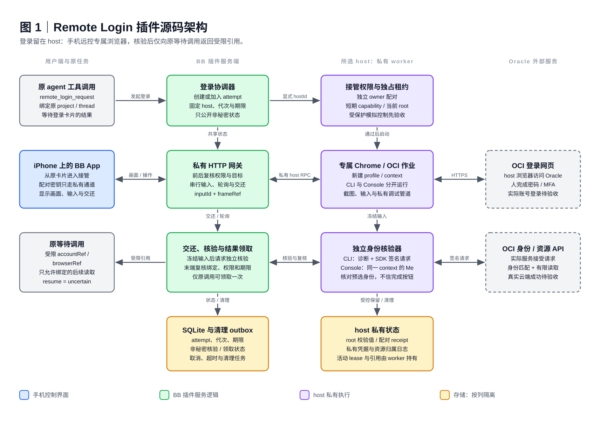
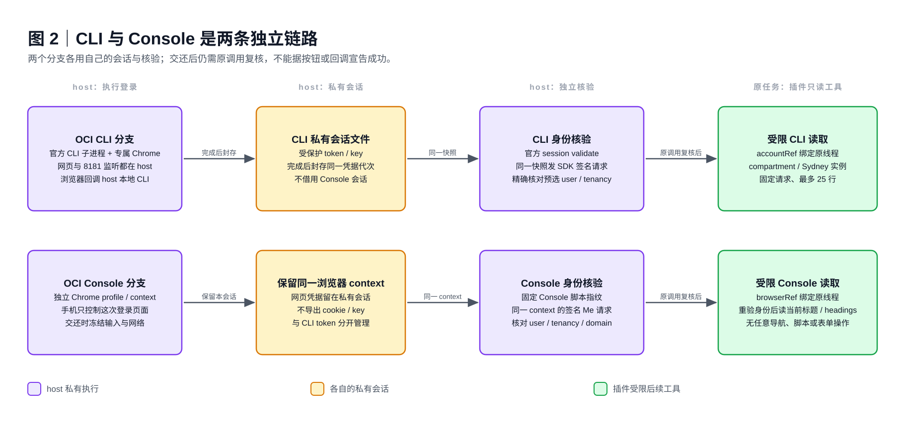

# Remote Login architecture

The person explicitly chooses remote takeover or a visible plugin-owned browser on the selected host. Browser login, the OCI CLI process and its localhost callback remain on that host. The plugin uses only the public BB Plugin SDK and does not change BB core.

These diagrams describe the implemented experimental source, exercised with local controlled fixtures. They do not establish real iPhone, Oracle-account or production native-result acceptance. Colours show responsibility, not acceptance status.

The diagrams show the remote control path. In [host mode](host-login.md), direct input to the visible owned window replaces the phone frame/input path. The same private authority, independent verification and original-call continuation remain; the chosen mode is fixed and remote frames/input are refused for that run.

## Control and verification

- The original native tool call binds a login attempt to its thread, environment and explicit host. The phone receives a login card containing a non-secret attempt ID.
- An independently provisioned control key authorizes short-lived scoped control. The private frame/input gateway checks authority before and after host operations. The host owns its fresh Chrome profile and context.
- Each input carries a unique operation ID and the displayed frame reference. Duplicate operations and known obsolete observations are refused. Uncertain input delivery is never automatically resent.
- The CLI flow uses the owned official child, host-local callback, official diagnostic and an independent SDK signed request over the same sealed credentials. The Console flow separately verifies the active context through its signed self-identity request and pinned source delivery.
- Only the original waiting call can claim a verified opaque account/browser reference for the supported bounded read tools. SDK consumption acknowledgement and durable native-call reattachment are unavailable; delivery remains uncertain.
- SQLite stores non-secret attempt and cleanup state. Credentials, control verifier, resource journals and live leases remain within the private host boundary. Unknown resources are not adopted or deleted.

The SVG/PNG images and editable JSON specifications are kept together in this directory. See [runtime/method limits](provider-capabilities.md), [pairing](control-pairing.md), [input protocol](input-replay.md) and [fault evidence](fault-matrix.md).
